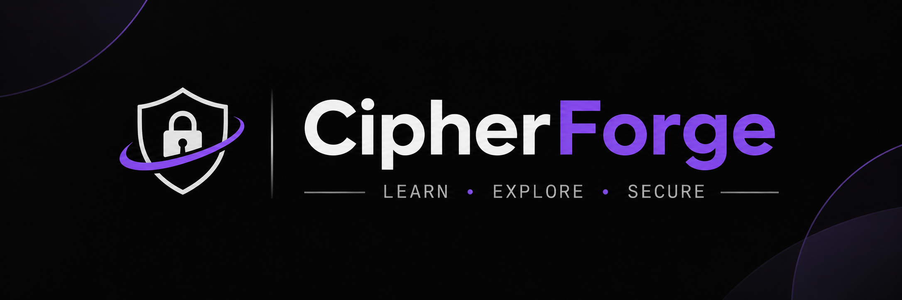

<div align="center">



# 🔐 CipherForge

**The Premier Community-Driven Educational & Learning Repository for Cryptography Algorithms**

*Master cryptography from first principles: from classical Caesar ciphers to modern AES, RSA, zero-knowledge proofs, and NIST post-quantum standards.*

[](https://www.python.org/)
[](#-curriculum-roadmap--master-index)
[](LICENSE)
[](CONTRIBUTING.md)
[](SECURITY.md)
[](#-getting-started)

</div>

---

> [!WARNING]
> ### 🛡️ Educational and Pedagogical Disclaimer
> **CipherForge is strictly designed for educational, academic, and research purposes.** Algorithms and sample scripts illustrate underlying mathematics, attack surfaces, and historical evolution. They have not undergone formal security audits and **must not be used to protect production data or secrets**. For production systems, always rely on audited, battle-tested implementations such as [cryptography (Python)](https://cryptography.io/), [libsodium](https://doc.libsodium.org/), or Google's [Tink](https://developers.google.com/tink).

---

## 📑 Table of Contents

- [🔐 CipherForge](#-cipherforge)
  - [📑 Table of Contents](#-table-of-contents)
  - [📚 Curriculum \& Master Algorithm Index](#-curriculum--master-algorithm-index)
    - [Level 01: Classical \& Historical Ciphers](#level-01-classical--historical-ciphers)
    - [Level 02: Symmetric Key Cryptography](#level-02-symmetric-key-cryptography)
    - [Level 03: Asymmetric / Public Key \& Key Exchange](#level-03-asymmetric--public-key--key-exchange)
    - [Level 04: Cryptographic Hashing, MACs \& AEAD](#level-04-cryptographic-hashing-macs--aead)
    - [Level 05: Digital Signatures \& Protocols](#level-05-digital-signatures--protocols)
    - [Level 06: Password Hashing \& Key Derivation (KDF)](#level-06-password-hashing--key-derivation-kdf)
    - [Level 07: Modern, Advanced \& Post-Quantum Cryptography](#level-07-modern-advanced--post-quantum-cryptography)
    - [Level 08: Capstone Project (SecureVault CLI)](#level-08-capstone-project-securevault-cli)
  - [🚀 Getting Started](#-getting-started)
    - [Prerequisites \& Quickstart](#prerequisites--quickstart)
    - [Launching the Interactive CLI](#launching-the-interactive-cli)
    - [Navigation \& Diagnostics Shortcuts](#navigation--diagnostics-shortcuts)
    - [Running with Docker](#running-with-docker)
  - [🎯 Track Your Progress \& Curated Paths](#-track-your-progress--curated-paths)
  - [🤝 Contributing \& Good First Issues](#-contributing--good-first-issues)
  - [⭐ Show Your Support](#-show-your-support)
  - [📜 License](#-license)


## 📚 Curriculum & Master Algorithm Index

### Level 01: Classical & Historical Ciphers
*Pen-and-paper ciphers, modular arithmetic, frequency analysis, and rotor machines.*  
📖 **[Level 01 Guide & Documentation](level-01-classical-ciphers/README.md)**

| Algorithm | Category | Description | Source File |
| :--- | :--- | :--- | :--- |
| **Caesar Cipher** | Substitution | Shift cipher over $\mathbb{Z}_{26}$ with frequency analysis tool | [`level-01-classical-ciphers/traditional-ciphers/Caesar.py`](level-01-classical-ciphers/traditional-ciphers/Caesar.py) |
| **Vigenère Cipher** | Polyalphabetic | Repeating keyword shift with Kasiski examination | [`level-01-classical-ciphers/traditional-ciphers/Vigenere.py`](level-01-classical-ciphers/traditional-ciphers/Vigenere.py) |
| **Playfair Cipher** | Digraph Substitution | 5×5 key matrix digram substitution cipher | [`level-01-classical-ciphers/traditional-ciphers/Playfair.py`](level-01-classical-ciphers/traditional-ciphers/Playfair.py) |
| **Hill Cipher** | Linear Algebra | Matrix transformation modulo 26 & modular inverse | [`level-01-classical-ciphers/traditional-ciphers/Hill.py`](level-01-classical-ciphers/traditional-ciphers/Hill.py) |
| **Enigma Machine** | Rotor Machine | WWII electro-mechanical rotor simulation & reflector | [`level-01-classical-ciphers/traditional-ciphers/Enigma.py`](level-01-classical-ciphers/traditional-ciphers/Enigma.py) |
| **Rail Fence Cipher** | Transposition | Zigzag geometric transposition & rail depth analyzer | [`level-01-classical-ciphers/traditional-ciphers/rail_fence.py`](level-01-classical-ciphers/traditional-ciphers/rail_fence.py) |

---

### Level 02: Symmetric Key Cryptography
*Block ciphers, Feistel networks, SPN structures, cipher modes, and stream ciphers.*  
📖 **[Level 02 Guide & Documentation](level-02-symmetric-crypto/README.md)**

| Subcategory | Algorithms Included | Source Directory |
| :--- | :--- | :--- |
| **Block Ciphers** | AES (128/192/256), DES, 3DES, Blowfish, Twofish, Camellia, IDEA, RC5, RC6, Serpent, Magma, Kuznyechik | [`level-02-symmetric-crypto/block-ciphers/`](level-02-symmetric-crypto/block-ciphers/) |
| **Cipher Modes** | ECB (insecure demo), CBC, CFB, OFB, CTR, GCM (AEAD), CCM (AEAD), XTS (disk encryption) | [`level-02-symmetric-crypto/cipher-modes/`](level-02-symmetric-crypto/cipher-modes/) |
| **Stream Ciphers** | ChaCha20 (RFC 8439), Salsa20, RC4 (broken), HC-128, Rabbit, A5/1 (GSM) | [`level-02-symmetric-crypto/stream-ciphers/`](level-02-symmetric-crypto/stream-ciphers/) |

---

### Level 03: Asymmetric / Public Key & Key Exchange
*Trapdoor one-way functions: Integer Factorization, Discrete Logarithms, and Elliptic Curves.*  
📖 **[Level 03 Guide & Documentation](level-03-asymmetric-crypto/README.md)**

| Subcategory | Algorithms Included | Source Directory |
| :--- | :--- | :--- |
| **Public Key Encryption** | RSA (OAEP), ElGamal, Rabin Cryptosystem, Paillier Additive Homomorphism | [`level-03-asymmetric-crypto/public-key-encryption/`](level-03-asymmetric-crypto/public-key-encryption/) |
| **Key Agreement** | Diffie-Hellman (DH), Elliptic Curve Diffie-Hellman (ECDH), X25519, MQV | [`level-03-asymmetric-crypto/key-exchange/`](level-03-asymmetric-crypto/key-exchange/) |
| **Elliptic Curves** | Curve25519, Twisted Edwards Ed25519, Weierstrass ECDSA point multiplication | [`level-03-asymmetric-crypto/elliptic-curves/`](level-03-asymmetric-crypto/elliptic-curves/) |

---

### Level 04: Cryptographic Hashing, MACs & AEAD
*Collision resistance, Merkle-Damgård vs. Sponge, message authentication, and authenticated encryption.*  
📖 **[Level 04 Guide & Documentation](level-04-hashing-and-macs/README.md)**

| Subcategory | Algorithms Included | Source Directory |
| :--- | :--- | :--- |
| **Hash Functions** | MD5, SHA-1, SHA-2 (224/256/384/512), SHA-3 (Keccak), BLAKE2, BLAKE3, RIPEMD-160, Whirlpool, Tiger | [`level-04-hashing-and-macs/hash-functions/`](level-04-hashing-and-macs/hash-functions/) |
| **Message Authentication** | HMAC (SHA-256), CMAC (NIST SP 800-38B), GMAC (Galois MAC), Poly1305 ($2^{130}-5$) | [`level-04-hashing-and-macs/message-authentication/`](level-04-hashing-and-macs/message-authentication/) |
| **Authenticated Encryption** | AES-GCM, AES-CCM, ChaCha20-Poly1305, AES-OCB | [`level-04-hashing-and-macs/authenticated-encryption/`](level-04-hashing-and-macs/authenticated-encryption/) |

---

### Level 05: Digital Signatures & Protocols
*Non-repudiation, deterministic signing, Schnorr aggregation, and network handshake simulations.*  
📖 **[Level 05 Guide & Documentation](level-05-signatures-and-protocols/README.md)**

| Subcategory | Algorithms Included | Source Directory |
| :--- | :--- | :--- |
| **Digital Signatures** | RSA-PSS / PKCS#1 v1.5, DSA (FIPS 186-4), ECDSA (secp256k1), Ed25519 (EdDSA), Schnorr (BIP-340) | [`level-05-signatures-and-protocols/digital-signatures/`](level-05-signatures-and-protocols/digital-signatures/) |
| **Secure Protocols** | TLS 1.3 Handshake simulation, SSH-2 Key Exchange, IPsec IKEv2, PGP / OpenPGP Hybrid, Kerberos | [`level-05-signatures-and-protocols/protocols/`](level-05-signatures-and-protocols/protocols/) |

---

### Level 06: Password Hashing & Key Derivation (KDF)
*Memory-hard functions, GPU/ASIC resistance, salting best practices, and protocol key derivation.*  
📖 **[Level 06 Guide & Documentation](level-06-password-and-kdf/README.md)**

| Algorithm | Standard | Core Defense Concept | Source File |
| :--- | :--- | :--- | :--- |
| **PBKDF2** | RFC 2898 / NIST SP 800-132 | Iteration stretching (600,000+ rounds) with HMAC-SHA256 | [`level-06-password-and-kdf/kdf-algorithms/pbkdf2.py`](level-06-password-and-kdf/kdf-algorithms/pbkdf2.py) |
| **BCrypt** | Eksblowfish (OpenBSD) | Adaptive work factor ($2^{\text{cost}}$ rounds), salt packaging | [`level-06-password-and-kdf/kdf-algorithms/bcrypt_module.py`](level-06-password-and-kdf/kdf-algorithms/bcrypt_module.py) |
| **Scrypt** | RFC 7914 (Colin Percival) | Memory-hard RAM caching ($N, r, p$) defeating custom ASIC chips | [`level-06-password-and-kdf/kdf-algorithms/scrypt_module.py`](level-06-password-and-kdf/kdf-algorithms/scrypt_module.py) |
| **Argon2** | RFC 9106 (PHC Winner) | Hybrid Argon2id / Argon2i / Argon2d memory-time defense | [`level-06-password-and-kdf/kdf-algorithms/argon2_module.py`](level-06-password-and-kdf/kdf-algorithms/argon2_module.py) |
| **HKDF** | RFC 5869 Extract-and-Expand | Domain-separated multi-key expansion for TLS 1.3 & Signal | [`level-06-password-and-kdf/kdf-algorithms/hkdf_module.py`](level-06-password-and-kdf/kdf-algorithms/hkdf_module.py) |

---

### Level 07: Modern, Advanced & Post-Quantum Cryptography
*Quantum-resistant schemes, homomorphic computation, multi-party computation, and zero-knowledge proofs.*  
📖 **[Level 07 Guide & Documentation](level-07-advanced-and-pqc/README.md)**

| Subcategory | Schemes Included | Source Directory |
| :--- | :--- | :--- |
| **Post-Quantum KEMs** | CRYSTALS-Kyber (ML-KEM / FIPS 203), NTRU, Classic McEliece | [`level-07-advanced-and-pqc/post-quantum-kems/`](level-07-advanced-and-pqc/post-quantum-kems/) |
| **Post-Quantum Signatures** | CRYSTALS-Dilithium (ML-DSA / FIPS 204), Falcon (FN-DSA), SPHINCS+ (SLH-DSA / FIPS 205) | [`level-07-advanced-and-pqc/post-quantum-signatures/`](level-07-advanced-and-pqc/post-quantum-signatures/) |
| **Homomorphic Encryption** | Paillier Additive Homomorphism (PHE), BFV / CKKS Fully Homomorphic (FHE) | [`level-07-advanced-and-pqc/homomorphic-encryption/`](level-07-advanced-and-pqc/homomorphic-encryption/) |
| **Secret Sharing & MPC** | Shamir's $(k, n)$ Threshold Secret Sharing (SSSS), Yao's Garbled Circuits, Oblivious Transfer | [`level-07-advanced-and-pqc/secret-sharing/`](level-07-advanced-and-pqc/secret-sharing/) |
| **Zero-Knowledge Proofs** | Interactive Schnorr ZKP, non-interactive zk-SNARKs (Groth16), zk-STARKs | [`level-07-advanced-and-pqc/zero-knowledge-proofs/`](level-07-advanced-and-pqc/zero-knowledge-proofs/) |

---

### Level 08: Capstone Project (SecureVault CLI)
*End-to-End Encrypted File Vault and Secure Messaging CLI.*  
📖 **[Level 08 Architecture & Roadmap](level-08-capstone-project/README.md)**

- 🔒 **Authenticated File Vault:** Encrypt and decrypt arbitrary files using AES-256-GCM or ChaCha20-Poly1305 with PBKDF2/Argon2 key derivation and binary header verification.
- 📨 **Asymmetric E2EE Messaging Envelope:** Ephemeral X25519 ECDH agreement + HKDF-SHA256 session key derivation + ChaCha20-Poly1305 + Ed25519 digital signature.
- 🔬 **Tamper Attack Simulation:** Automatic bit-flipping attack simulation showing how AEAD guarantees tamper-detection and integrity failure.
- 💻 **Runnable Source:** [`level-08-capstone-project/secure_vault.py`](level-08-capstone-project/secure_vault.py)

---

## 🚀 Getting Started

### Prerequisites & Quickstart

- **Python 3.10+** (Python 3.11+ recommended)
- **Git**

```bash
# 1. Clone the repository
git clone https://github.com/Aakash02A/CipherForge.git
cd CipherForge

# 2. Create and activate a virtual environment
python -m venv .venv

# Windows (PowerShell)
.venv\Scripts\Activate.ps1

# Linux / macOS
source .venv/bin/activate

# 3. Install core dependencies
pip install --upgrade pip
pip install -r requirements.txt
```

### Launching the Interactive CLI

Start the interactive terminal explorer:

```bash
python main.py
```

### Navigation & Diagnostics Shortcuts

| Command | Action | Description |
| :---: | :--- | :--- |
| `1` – `8` | **Select Level** | Navigate to any of the 8 progressive levels |
| `D` | **Run Diagnostics** | Instantly verifies import integrity and dependencies for all 90 registered modules |
| `S` | **Setup Guide** | Inspects package configuration and shows environment status |
| `H` | **Help** | Displays all interactive command shortcuts |
| `CLS` | **Clear Screen** | Clears the terminal screen and redraws the banner |
| `Q` | **Quit** | Exits the toolkit |

### Running with Docker

Run CipherForge inside an isolated Docker container without configuring local Python packages:

```bash
docker compose run --rm crypto-toolkit
```

---

## 🎯 Track Your Progress & Curated Paths

CipherForge supports structured learning tracks tailored to your background and career goals:

- 📋 **[Interactive Learner Checklist (PROGRESS.md)](docs/PROGRESS.md):** Track your completion across all 8 levels and test your knowledge with self-assessment checkpoints.
- 🛣️ **[Curated Learning Tracks (TRACKS.md)](docs/TRACKS.md):**
  - **Track 1:** 2-Week Security Interview Sprint
  - **Track 2:** Classical to Modern Cryptography Mastery
  - **Track 3:** Applied Cybersecurity & PKI Specialist
  - **Track 4:** Privacy-Preserving & Post-Quantum Frontier

---

## 🤝 Contributing & Good First Issues

We welcome contributions from developers, researchers, students, and cryptographers worldwide! 

Whether you want to add a new algorithm, improve docstrings, contribute unit tests, or build cryptanalysis attack simulations:

- 📖 **Check our [Contribution Guide (CONTRIBUTING.md)](CONTRIBUTING.md)** for coding conventions and PR workflows.
- 🏷️ Look for **Good First Issues**:
  - Adding automated unit tests in `tests/`
  - Writing attack demonstrations (e.g. padding oracle simulation, CBC bit-flipping)
  - Profiling memory and Big-O computational benchmarks
  - Adding visualization scripts for mathematical structures

---

## ⭐ Show Your Support

If CipherForge helped you understand cryptography, ace a security interview, or design better software, **please consider starring this repository!** ⭐ It motivates contributors and helps fellow learners discover this project.

---

## 📜 License

This project is open-source under the **[MIT License](LICENSE)**.
