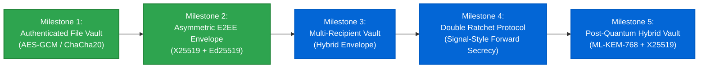

# 🛡️ Level 08 Capstone: SecureVault & End-to-End Encrypted Messaging CLI

Welcome to the **Capstone Project** of CipherForge. This project synthesizes the cryptographic primitives studied across Levels 01 through 07 into a unified, production-style, end-to-end encrypted application: **SecureVault CLI**.

---

## 🏗️ System Architecture & Specification

The SecureVault system consists of two core subsystems:
1. **The Authenticated File Vault Subsystem:** Secure, tamper-evident symmetric file encryption using modern AEAD schemes (AES-256-GCM and ChaCha20-Poly1305) with hardened key derivation.
2. **The Asymmetric Secure Messaging Subsystem:** An End-to-End Encrypted (E2EE) envelope architecture providing forward secrecy, identity authentication, and non-repudiation using X25519, Ed25519, HKDF-SHA256, and ChaCha20-Poly1305.

```text
               ┌────────────────────────────────────────────────────────┐
               │                SecureVault CLI Capstone                │
               └──────────────────────────┬─────────────────────────────┘
                                          │
            ┌─────────────────────────────┴─────────────────────────────┐
            ▼                                                           ▼
┌───────────────────────────────┐                       ┌───────────────────────────────┐
│     Symmetric File Vault      │                       │   Asymmetric E2EE Messaging   │
│  • AES-256-GCM (128-bit Tag)  │                       │  • Ephemeral X25519 ECDH      │
│  • ChaCha20-Poly1305 (RFC8439)│                       │  • HKDF-SHA256 Key Derivation │
│  • PBKDF2-HMAC-SHA256 (300k)  │                       │  • Ed25519 Digital Signatures │
│  • Authenticated Headers (AAD)│                       │  • Tamper-Evident Envelope    │
└───────────────────────────────┘                       └───────────────────────────────┘
```

---

## 🛡️ Threat Model & Security Guarantees

SecureVault is evaluated against the classic **Dolev-Yao Adversary Model**, assuming the attacker has complete control of the network communication channel (can eavesdrop, modify, inject, replay, or drop messages).

| Threat / Attack Vector | Mitigation Strategy in SecureVault |
| :--- | :--- |
| **Passive Eavesdropping** | 256-bit symmetric encryption (AES-256-GCM / ChaCha20) renders ciphertext indistinguishable from random noise under IND-CPA. |
| **Active Tampering / Bit-Flipping** | 128-bit polynomial authentication tags (GHASH / Poly1305) over ciphertext and header AAD. Even a 1-bit flip triggers `InvalidTag` rejection. |
| **Dictionary / Password Cracking** | 128-bit random salt per file + 300,000 rounds of PBKDF2-HMAC-SHA256 (or Argon2id) thwarts rainbow tables and GPU brute force. |
| **Man-in-the-Middle (MitM)** | Sender signs the ephemeral public key and ciphertext using their long-term **Ed25519 private key**. |
| **Replay & Reordering** | Associated Authenticated Data (AAD) binds the magic header, cipher identifier, salt, and nonce directly to the authentication tag. |
| **Future Compromise (Forward Secrecy)**| Each message utilizes an ephemeral X25519 keypair discarded after key exchange, ensuring past messages cannot be decrypted if long-term keys leak. |

---

## 📐 Data Framing & Wire Format Specifications

### 1. Binary File Vault Wire Format (`.vault` files)

```text
 0                   1                   2                   3
 0 1 2 3 4 5 6 7 8 9 0 1 2 3 4 5 6 7 8 9 0 1 2 3 4 5 6 7 8 9 0 1
+-+-+-+-+-+-+-+-+-+-+-+-+-+-+-+-+-+-+-+-+-+-+-+-+-+-+-+-+-+-+-+-+
|                      MAGIC HEADER: "CFVAULT1"                 |
|                            (8 bytes)                          |
+-+-+-+-+-+-+-+-+-+-+-+-+-+-+-+-+-+-+-+-+-+-+-+-+-+-+-+-+-+-+-+-+
| CIPHER ID (1B)|               SALT (16 bytes)                 |
| (0x01 or 0x02)|                                               |
+-+-+-+-+-+-+-+-+                                               +
|                                                               |
+-+-+-+-+-+-+-+-+-+-+-+-+-+-+-+-+-+-+-+-+-+-+-+-+-+-+-+-+-+-+-+-+
|                       NONCE / IV (12 bytes)                   |
|                                                               |
+-+-+-+-+-+-+-+-+-+-+-+-+-+-+-+-+-+-+-+-+-+-+-+-+-+-+-+-+-+-+-+-+
|                                                               |
|                   CIPHERTEXT + 16-BYTE AUTH TAG               |
|                           (Variable Length)                   |
|                                                               |
+-+-+-+-+-+-+-+-+-+-+-+-+-+-+-+-+-+-+-+-+-+-+-+-+-+-+-+-+-+-+-+-+
```

- **Header (AAD):** `MAGIC (8B)` + `CIPHER_ID (1B)` + `SALT (16B)` + `NONCE (12B)` = **37 bytes**.
- **Cipher Identifiers:**
  - `0x01`: AES-256-GCM
  - `0x02`: ChaCha20-Poly1305
- **Authenticated Data Binding:** The 37-byte header is passed directly as Associated Data (`aad`) to the AEAD encryptor. Modifying any byte in the header invalidates the tag and halts decryption.

---

### 2. Secure Messaging Envelope (JSON Envelope Format)

```json
{
  "version": 1,
  "sender": "Alice",
  "sender_sign_pub": "Base64(Ed25519 32-byte public key)",
  "ephemeral_dh_pub": "Base64(X25519 32-byte ephemeral public key)",
  "salt": "Base64(16-byte random salt)",
  "nonce": "Base64(12-byte random nonce)",
  "ciphertext": "Base64(Encrypted payload + 16-byte Poly1305 tag)",
  "signature": "Base64(Ed25519 64-byte signature over transcript)"
}
```

The signed transcript binds:
$$\text{Transcript} = \text{EphemeralPub}_{\text{X25519}} \;\parallel\; \text{Salt} \;\parallel\; \text{Nonce} \;\parallel\; \text{Ciphertext}$$
This prevents an attacker from splicing a different ephemeral key or replacing the ciphertext payload without invalidating Alice's digital signature.

---

## 🚀 Running the Capstone Project

### Via Main Interactive Menu:
```bash
python main.py
# Select option: 8
```

### Standalone Direct Execution:
```bash
python -m level-08-capstone-project.secure_vault
```

### Interactive Features Available:
1. **Encrypt File to Authenticated Vault:** Encrypt any binary or text file into a `.vault` container with chosen passphrase and AEAD cipher.
2. **Decrypt & Authenticate Vault:** Decrypt `.vault` container and verify cryptographic authentication tag.
3. **Run End-to-End Encrypted Messaging (E2EE) Simulation:** Demonstrates key generation, ephemeral ECDH agreement, HKDF key derivation, AEAD encryption, and Ed25519 signature verification between simulated users Alice and Bob.
4. **Run Tamper Attack Simulation:** Automatically encrypts a payload, flips a single bit in the ciphertext, and demonstrates how AEAD detects the corruption and aborts decryption.

---

## 🗺️ Capstone Milestone Roadmap



### Milestone Breakdown:
- [x] **Milestone 1: Authenticated File Vault Engine (Complete)**
  - AES-256-GCM and ChaCha20-Poly1305 AEAD implementations.
  - PBKDF2 key derivation with 128-bit cryptographically secure salts.
  - Authenticated Associated Data (AAD) header binding.
- [x] **Milestone 2: Asymmetric E2EE Messaging Envelope (Complete)**
  - Ephemeral X25519 Diffie-Hellman key agreement for forward secrecy.
  - HKDF-SHA256 session key derivation.
  - Ed25519 digital signature generation and verification.
  - Active bit-flip tamper simulation and attack detection.
- [ ] **Milestone 3: Multi-Recipient File Sharing (Planned)**
  - Single symmetric payload key encrypted for multiple recipient public keys (PGP-style keyring).
  - Key revocation and public key directory simulation.
- [ ] **Milestone 4: Signal-Style Double Ratchet Protocol (Planned)**
  - Symmetric KDF chain ratcheting + Diffie-Hellman ratcheting for continuous forward and post-compromise secrecy.
  - Out-of-order message handling with skipped-key caches.
- [ ] **Milestone 5: Post-Quantum Hybrid Cryptographic Vault (Planned)**
  - Dual encapsulation combining classical X25519 with lattice-based **ML-KEM-768 (CRYSTALS-Kyber)**.
  - Dual digital signatures combining **Ed25519** with **ML-DSA-65 (CRYSTALS-Dilithium)**.

